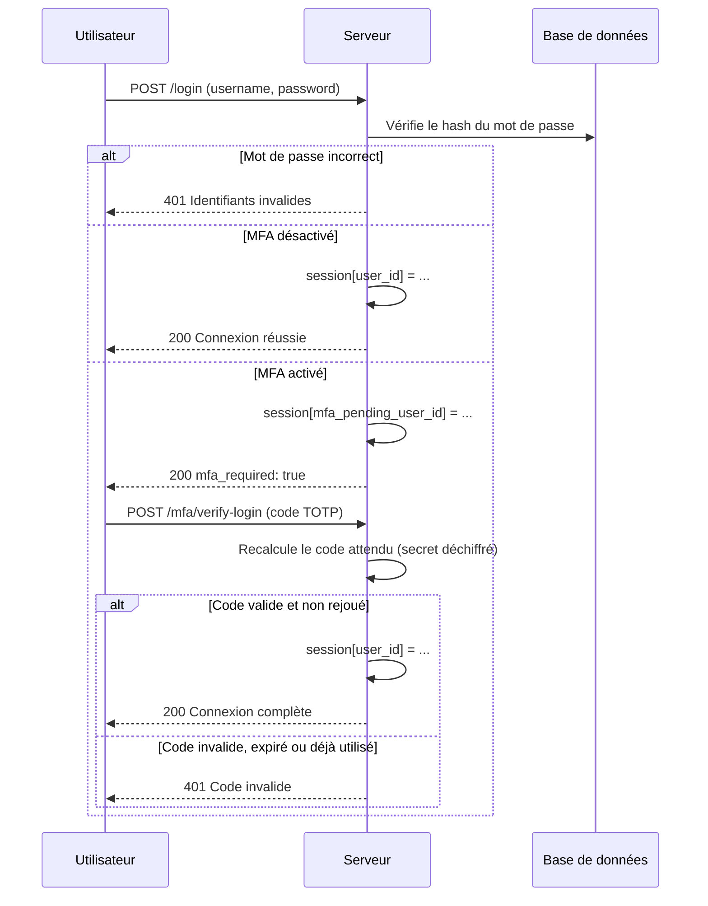
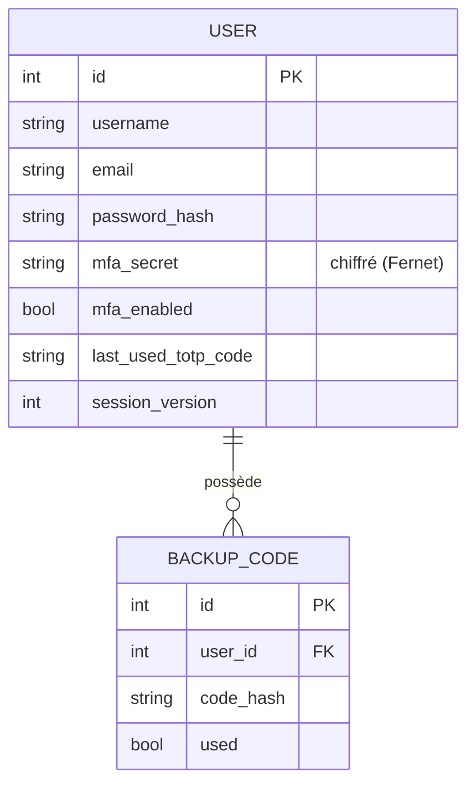

# Secure Login with MFA

Système d'authentification sécurisé construit avec Flask, incluant une authentification à deux facteurs (TOTP) complète, des codes de récupération, et un ensemble de protections contre les attaques courantes (brute-force, CSRF, injection SQL, vol de session).

Ce projet a été développé comme exercice pratique de sécurité applicative : au-delà de l'implémentation, il inclut un véritable audit de sécurité mené sur l'application elle-même, avec identification, correction et validation de plusieurs vulnérabilités réelles (voir [Sécurité](#sécurité--findings)).

---

## Sommaire

- [Fonctionnalités](#fonctionnalités)
- [Stack technique](#stack-technique)
- [Architecture](#architecture)
- [Installation](#installation)
- [Utilisation de l'API](#utilisation-de-lapi)
- [Sécurité — Findings](#sécurité--findings)
- [Protections en place](#protections-en-place)
- [Limites connues](#limites-connues)
- [Structure du projet](#structure-du-projet)

---

## Fonctionnalités

- Inscription / connexion avec mots de passe hashés (bcrypt)
- Authentification à deux facteurs (TOTP, compatible Google Authenticator / Aegis)
- Codes de récupération à usage unique en cas de perte du second facteur
- Sessions sécurisées avec invalidation réelle à la déconnexion
- Protection anti brute-force (rate limiting)
- Protection CSRF sur toutes les routes sensibles
- Journalisation structurée des événements de sécurité
- Secret MFA chiffré en base de données

## Stack technique

| Catégorie | Choix |
|---|---|
| Backend | Python, Flask |
| Base de données | SQLite + SQLAlchemy (ORM) |
| Migrations | Flask-Migrate (Alembic) |
| Mots de passe | Flask-Bcrypt |
| MFA (TOTP) | PyOTP + qrcode |
| Chiffrement du secret MFA | cryptography (Fernet) |
| Rate limiting | Flask-Limiter |
| CSRF | Flask-WTF |
| Logging de sécurité | module `logging` standard, fichier dédié avec rotation |

## Architecture

### Flux d'authentification



### Modèle de données



## Installation

### Prérequis
- Python 3.11+
- Une application Authenticator (Google Authenticator, Aegis, ou équivalent)

### Étapes

```bash
# Cloner le dépôt
git clone https://github.com/<ton-compte>/secure-login-mfa.git
cd secure-login-mfa

# Créer et activer l'environnement virtuel
python -m venv venv
source venv/bin/activate        # Linux / macOS
venv\Scripts\Activate.ps1       # Windows PowerShell

# Installer les dépendances
pip install -r requirements.txt
```

### Configuration

Crée un fichier `.env` à la racine du projet :

```env
SECRET_KEY=              # python -c "import secrets; print(secrets.token_hex(32))"
DATABASE_URL=sqlite:///instance/database.db
MFA_ENCRYPTION_KEY=      # python -c "from cryptography.fernet import Fernet; print(Fernet.generate_key().decode())"
FLASK_ENV=development
```

### Initialiser la base de données

```bash
flask db upgrade
```

### Lancer l'application

```bash
python run.py
```

L'API est disponible sur `http://127.0.0.1:5000`.

## Utilisation de l'API

| Méthode | Route | Description | Auth requise |
|---|---|---|---|
| POST | `/api/auth/register` | Créer un compte | Non |
| POST | `/api/auth/login` | Connexion (étape 1 : mot de passe) | Non |
| POST | `/api/auth/logout` | Déconnexion | Session |
| GET | `/api/auth/csrf-token` | Récupérer un token CSRF | Non |
| GET | `/api/auth/dashboard` | Exemple de route protégée | Session complète |
| POST | `/api/auth/mfa/setup` | Générer le secret MFA + QR code | Session complète |
| POST | `/api/auth/mfa/confirm` | Confirmer et activer le MFA | Session complète |
| POST | `/api/auth/mfa/verify-login` | Connexion (étape 2 : code TOTP) | Session partielle (MFA pending) |
| POST | `/api/auth/mfa/verify-backup-code` | Connexion via code de récupération | Session partielle (MFA pending) |

Toutes les routes POST (hors `/login` et `/register`) nécessitent un header `X-CSRFToken` obtenu via `/api/auth/csrf-token`.

### Exemple — inscription

```bash
curl -X POST http://127.0.0.1:5000/api/auth/register \
  -H "Content-Type: application/json" \
  -d '{"username": "alice", "email": "alice@example.com", "password": "MotDePasse123"}'
```

## Sécurité — Findings

L'application a fait l'objet d'un audit de sécurité actif (interception de trafic avec Burp Suite, script de brute-force, tentatives d'injection SQL, fuzzing de requêtes malformées). Trois vulnérabilités réelles ont été identifiées, corrigées, puis revalidées par un nouveau test.

| # | Vulnérabilité | Impact | Correction | Statut |
|---|---|---|---|---|
| 1 | **Rejeu de code TOTP** — un code valide pouvait être réutilisé plusieurs fois dans sa fenêtre de 30s | Un code intercepté pouvait être rejoué pour obtenir un accès supplémentaire | Mémorisation du dernier code validé par utilisateur (`last_used_totp_code`), comparé avant toute vérification TOTP | ✅ Corrigé et retesté |
| 2 | **Fuite d'informations via page de debug** — un champ JSON de type inattendu provoquait une exception non gérée, exposant la page de debug Werkzeug (code source, chemins serveur, console interactive) | Exécution de code à distance potentielle si exposé publiquement avec `debug=True` | Validation stricte du type (`isinstance`) de chaque champ avant traitement, sur toutes les routes | ✅ Corrigé et retesté |
| 3 | **Session non invalidée après déconnexion** — les sessions Flask étant stockées côté client (signées, non chiffrées), un cookie copié avant un logout restait valide après celui-ci | Vol de session persistant malgré une déconnexion explicite | Compteur `session_version` en base, incrémenté au logout et vérifié à chaque requête authentifiée | ✅ Corrigé et retesté |

Méthodologie : chaque finding suit le cycle **découverte → reproduction → correction → nouveau test confirmant la correction**, documenté intégralement durant le développement.

## Protections en place

- **Mots de passe** : hashés avec bcrypt (salt automatique, jamais stockés en clair)
- **MFA (TOTP)** : secret chiffré en base (Fernet), anti-rejeu, codes de récupération hashés à usage unique
- **Sessions** : cookies `HttpOnly`, `SameSite=Lax`, expiration à 30 min, invalidation réelle au logout
- **CSRF** : token obligatoire sur toutes les routes sensibles (hors inscription/connexion initiale)
- **Brute-force** : rate limiting par IP (5 tentatives / minute sur le login, 5 / 5 min sur la vérification MFA)
- **Injection SQL** : neutralisée structurellement par l'usage de requêtes paramétrées (SQLAlchemy)
- **Logging** : journal de sécurité dédié, résistant à l'injection de logs, excluant toute donnée sensible
- **Headers HTTP** : `X-Content-Type-Options`, `X-Frame-Options`, `Strict-Transport-Security`
- **Énumération d'utilisateurs** : messages d'erreur génériques, identiques pour username inexistant ou mot de passe incorrect

## Limites connues

Ce projet a été développé en environnement local à but d'apprentissage. Les limites suivantes sont identifiées et assumées :

- **Pas de HTTPS en développement** : les échanges (y compris le mot de passe en transit) ne sont pas chiffrés sur le réseau. Indispensable en production.
- **Rate limiting par IP et en mémoire** : contournable par rotation d'adresse IP, réinitialisé au redémarrage du serveur. Une solution de production utiliserait un stockage partagé (Redis) et des règles complémentaires (verrouillage de compte, CAPTCHA).
- **Invalidation de session globale** : `session_version` déconnecte tous les appareils d'un utilisateur à la fois ; une gestion par appareil nécessiterait une table de sessions dédiée.
- **Serveur de développement** : Werkzeug n'est pas conçu pour la production (voir l'avertissement affiché au démarrage) ; un déploiement réel utiliserait Gunicorn ou équivalent derrière un reverse proxy.

## Structure du projet

```
secure-login-mfa/
├── app/
│   ├── models/          # Modèles SQLAlchemy (User, BackupCode)
│   ├── routes/           # Routes Flask (auth, mfa)
│   ├── crypto_utils.py    # Chiffrement du secret MFA
│   ├── security_logger.py # Journalisation de sécurité
│   ├── utils.py           # Décorateurs (login_required)
│   └── __init__.py        # Factory de l'application
├── migrations/            # Historique des migrations de schéma
├── scripts/                # Scripts d'audit (test de brute-force)
├── requirements.txt
├── run.py
└── README.md
```

---

Projet développé dans le cadre d'un apprentissage pratique de la cybersécurité appliquée (authentification, cryptographie, tests d'intrusion).
